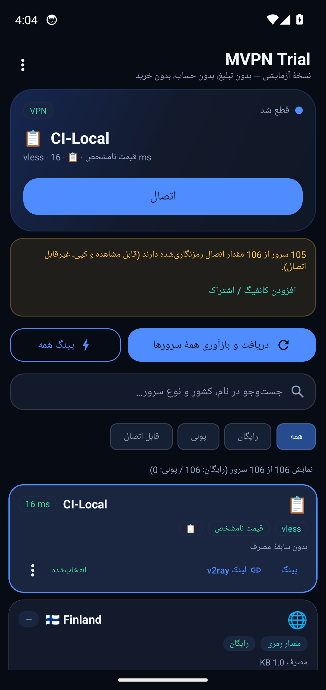

# آزمون اتصال واقعی (CI)

- زمان: 2026-10-26T04:04:44Z
- سرور آزمون: `CI-Local`
- کانفیگ: `vless://11111111-2222-3333-4444-555555555555@10.0.2.2:10086?encryption…`
- آدرس آزمون: `https://www.gstatic.com/generate_204`

## گام‌ها

- ورود کانفیگ با intent: `vless://11111111-2222-3333-4444-555555555555@10.0.2.2:10086?…`
- کانفیگ در فهرست دیده شد
- دکمهٔ اتصال زده شد
- دیالوگ مجوز VPN تأیید شد
- وضعیت «متصل» در برنامه دیده شد
- رابط tun0 در دستگاه: موجود
- ابزار آزمون ترافیک داخل دستگاه: nc
- curl از پوستهٔ ادمین (HTTPS): خروجی='204' — ردِ سرور: دیده شد (159 بایت لاگ تازه)
-   نمونهٔ لاگ سرور: `2026/10/26 04:03:49.931648 from 127.0.0.1:51828 accepted tcp:www.gstatic.com:80`
- ابزار آزمون ترافیک داخل دستگاه: nc
- curl از پوستهٔ ادمین (HTTP): خروجی='204' — ردِ سرور: دیده شد (574 بایت لاگ تازه)
-   نمونهٔ لاگ سرور: `2026/10/26 04:03:54.131708 from 127.0.0.1:40014 accepted tcp:www.gstatic.com:443`
- ابزار آزمون ترافیک داخل دستگاه: nc
- curl از پوستهٔ ادمین (IPv4): خروجی='HTTP/1.1 301 Moved Permanently' — ردِ سرور: دیده شد (476 بایت لاگ تازه)
-   نمونهٔ لاگ سرور: `2026/10/26 04:03:58.342722 from 127.0.0.1:40092 accepted tcp:www.googleapis.com:443`
- اجرای «پینگ همه» و بررسی اینکه سرور متصل عوض نشود
- وضعیت بعد از پینگ همه: `متصل — CI-Local (VPN)`
- پس از قطع: tun0 حذف شد

## تصاویر

## نتیجه

**موفق** — ورود کانفیگ، اتصال، عبور ترافیک از تونل، پایداری انتخاب سرور و قطع اتصال همه درست کار کردند.
