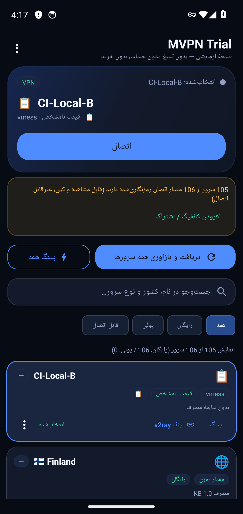
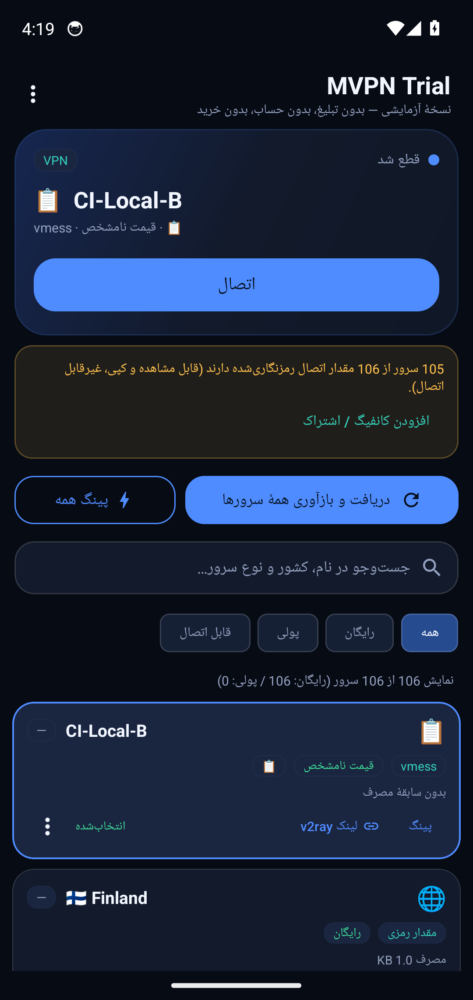

# آزمون اتصال واقعی (CI)

- زمان: 2026-10-26T04:19:19Z
- سرورهای آزمون: `CI-Local-A`, `CI-Local-B`
- آدرس آزمون: `https://www.gstatic.com/generate_204`

## گام‌ها

- ورود کانفیگ اول با intent: `vless://11111111-2222-3333-4444-555555555555@10.0.2.2:10086?…`
- کانفیگ «CI-Local-A» در فهرست دیده شد
- دکمهٔ اتصال زده شد
- دیالوگ مجوز VPN تأیید شد
- وضعیت «متصل — CI-Local-A» دیده شد
- رابط tun0: موجود
- درخواست از پوستهٔ ادمین (HTTPS): خروجی='204' — ردِ سرور: دیده شد (1532 بایت لاگ تازه)
-   نمونهٔ لاگ سرور: `2026/10/26 04:16:29.258178 from 127.0.0.1:38500 accepted tcp:www.gstatic.com:443`
- درخواست از پوستهٔ ادمین (HTTP): خروجی='204' — ردِ سرور: دیده شد (637 بایت لاگ تازه)
-   نمونهٔ لاگ سرور: `2026/10/26 04:16:33.900681 from 127.0.0.1:55090 accepted tcp:connectivitycheck.gstatic.com:80`
- اجرای «پینگ همه» و بررسی اینکه سرور متصل عوض نشود
- وضعیت بعد از پینگ همه: `متصل — CI-Local-A (VPN)`
- ورود کانفیگ دوم: `vmess://eyJ2IjoiMiIsInBzIjoiQ0ktTG9jYWwtQiIsImFkZCI6IjEwLjAu…`
- برچسب دکمهٔ اتصال در این حالت: `اتصال`
- درخواست تغییر سرور زده شد
- **تونل به سرور دوم منتقل نشد**
- **دکمهٔ قطع اتصال پیدا نشد**

## تصاویر

## نتیجه

**ناموفق**: switch-failed, disconnect-button
