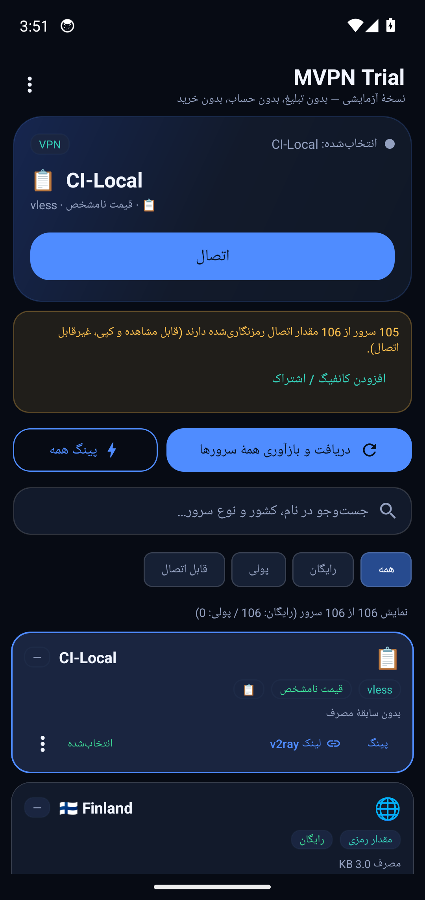
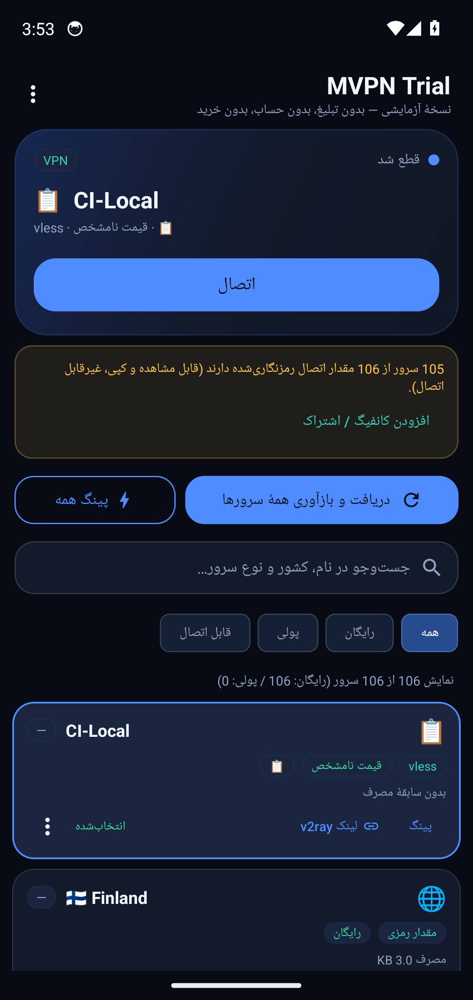
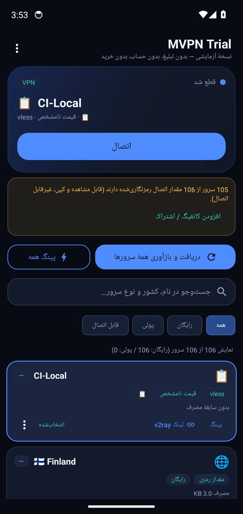

# آزمون اتصال واقعی (CI)

- زمان: 2026-10-26T03:53:55Z
- سرور آزمون: `CI-Local`
- کانفیگ: `vless://11111111-2222-3333-4444-555555555555@10.0.2.2:10086?encryption…`
- آدرس آزمون: `https://www.gstatic.com/generate_204`

## گام‌ها

- ورود کانفیگ با intent: `vless://11111111-2222-3333-4444-555555555555@10.0.2.2:10086?…`
- کانفیگ در فهرست دیده شد
- دکمهٔ اتصال زده شد
- دیالوگ مجوز VPN تأیید شد
- **برنامه به وضعیت متصل نرسید**
- رابط tun0 در دستگاه: موجود نیست
- ابزار آزمون ترافیک داخل دستگاه: nc
- curl از پوستهٔ ادمین (HTTPS): خروجی='204' — ردِ سرور: دیده نشد (0 بایت لاگ تازه)
- ابزار آزمون ترافیک داخل دستگاه: nc
- curl از پوستهٔ ادمین (HTTP): خروجی='204' — ردِ سرور: دیده نشد (0 بایت لاگ تازه)
- ابزار آزمون ترافیک داخل دستگاه: nc
- curl از پوستهٔ ادمین (IPv4): خروجی='HTTP/1.1 301 Moved Permanently' — ردِ سرور: دیده نشد (0 بایت لاگ تازه)
- اجرای «پینگ همه» روی اتصال برقرار
- وضعیت بعد از پینگ همه: `انتخاب‌شده`
- **پس از پینگ همه، اتصال/انتخاب عوض شد (همان نقص اپ اصلی)**
- **دکمهٔ قطع اتصال پیدا نشد**

## تصاویر

## نتیجه

**ناموفق**: not-connected, no-tun, server-never-saw-traffic, selection-changed-after-ping-all, disconnect-button
