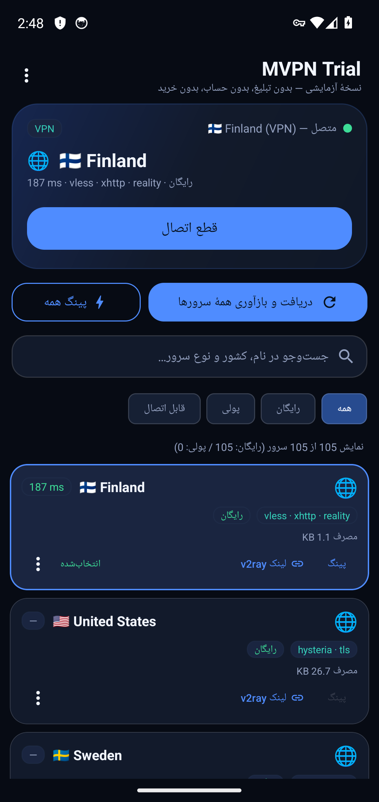

# آزمون اتصال واقعی به بک‌اند اصلی (بدون هیچ ورودی کاربر)

- زمان: 2026-10-26T14:49:02Z
- آدرس آزمون: `http://1.1.1.1/cdn-cgi/trace`

## گام‌ها

- پاک‌کردن دادهٔ برنامه (بدون کش، بدون کانفیگ ذخیره‌شده)
- ابزار HTTP روی شبیه‌ساز: `nc`
- IP خروج پیش از اتصال: `None` (success/United States)
- درخواست بدون تونل: HTTP 200
- فهرست بارگذاری شد: 3 ردیف روی صفحه — خلاصه: `نمایش 105 از 105 سرور (رایگان: 105 / پولی: 0)`
- نمونهٔ برچسب ردیف‌ها: `🇫🇮 Finland`، `🇺🇸 United States`، `🇸🇪 Sweden`
- پایان پینگ همه: بله
- سروری که برنامه خودش انتخاب کرد: `🌐  🇫🇮 Finland`
- اتصال به سرور انتخاب‌شده: `🌐  🇫🇮 Finland`
- دیالوگ مجوز VPN تأیید شد
- وضعیت تونل: `متصل — &#127467;&#127470; Finland (VPN)`
- رابط tun0: موجود
- درخواست از داخل تونل: HTTP 301
- درخواست از داخل تونل: HTTP 301
- درخواست از داخل تونل: HTTP 301
- ترافیک از این ردیف عبور نکرد؛ سرور بعدی آزموده می‌شود
- تلاش 2: اتصال به `🇫🇮 Finland`
- وضعیت تونل: `متصل — &#127467;&#127470; Finland (VPN)`
- رابط tun0: موجود
- درخواست از داخل تونل: HTTP 301
- درخواست از داخل تونل: HTTP 301
- درخواست از داخل تونل: HTTP 301
- ترافیک از این ردیف عبور نکرد؛ سرور بعدی آزموده می‌شود

## تصاویر

## نتیجه

**ناموفق**: no-traffic-1, no-traffic-2, no-server-passed-traffic
