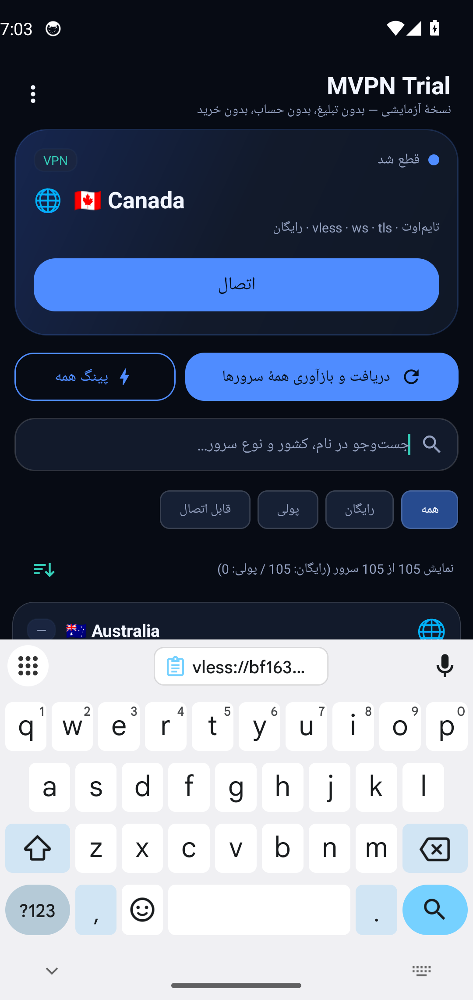

# آزمون اتصال واقعی به بک‌اند اصلی (بدون هیچ ورودی کاربر)

- زمان: 2026-10-27T07:03:49Z
- آدرس آزمون: `http://1.1.1.1/cdn-cgi/trace`
- سرور متصل‌شده: `🇫🇮 Finland`

## گام‌ها

- پاک‌کردن دادهٔ برنامه (بدون کش، بدون کانفیگ ذخیره‌شده)
- ابزار HTTP روی شبیه‌ساز: `nc`
- IP خروج پیش از اتصال: `None` (success/United States)
- درخواست بدون تونل: HTTP 301
- فهرست بارگذاری شد: 3 ردیف روی صفحه — خلاصه: `نمایش 105 از 105 سرور (رایگان: 105 / پولی: 0)`
- نمونهٔ برچسب ردیف‌ها: `🇫🇮 Finland`، `🇺🇸 United States`، `🇦🇺 Australia`
- مرتب‌سازی: درست — سه ردیف اول: `🇦🇺 Australia`، `🇦🇺 Australia`، `🇨🇦 Canada`
- کپی همهٔ لینک‌ها: درست — 102 لینک v2ray در کلیپ‌بورد قرار گرفت
- پایان پینگ همه: بله
- سروری که برنامه خودش انتخاب کرد: `🌐  🇫🇮 Finland` (پینگ 179 ms)
- ردیف‌های دارای پینگ در فهرست: 26
- اتصال به سرور انتخاب‌شده: `🇫🇮 Finland`
- دیالوگ مجوز VPN تأیید شد
- وضعیت تونل: `متصل — &#127467;&#127470; Finland (VPN)`
- رابط tun0: موجود
- درخواست از داخل تونل: HTTP 301
- ترافیک از تونل عبور کرد (تلاش 1 از 5)
- IP خروج داخل تونل: `2a01:4f9:c010:7583::1` (FI — HEL)
- ردیف‌های نامزد برای تغییر سرور: 25 (از 26 ردیف دارای پینگ)
- تغییر سرور به: `🇦🇺 Australia` (164 ms)
- دیالوگ مجوز VPN تأیید شد
- خطاهای برنامه:
```
سنجش تأخیر ناموفق
go.Universe$proxyerror: Get "https://www.gstatic.com/generate_204": io: read/write on closed pipe
go.Universe$proxyerror: Get "https://www.gstatic.com/generate_204": net/http: TLS handshake timeout
```
- تغییر سرور به: `🇨🇦 Canada` (76 ms)
- خطاهای برنامه:
```
سنجش تأخیر ناموفق
go.Universe$proxyerror: Get "https://www.gstatic.com/generate_204": io: read/write on closed pipe
go.Universe$proxyerror: Get "https://www.gstatic.com/generate_204": net/http: TLS handshake timeout
ترافیک از تونل عبور نکرد؛ اتصال لغو شد (🇨🇦 Canada)
```
- تغییر سرور به: `🇨🇦 Canada` (83 ms)
- خطاهای برنامه:
```
سنجش تأخیر ناموفق
go.Universe$proxyerror: Get "https://www.gstatic.com/generate_204": io: read/write on closed pipe
go.Universe$proxyerror: Get "https://www.gstatic.com/generate_204": net/http: TLS handshake timeout
ترافیک از تونل عبور نکرد؛ اتصال لغو شد (🇨🇦 Canada)
```
- دکمه در وضعیت «اتصال» است؛ ابتدا ردیف متصل انتخاب می‌شود: `🌐  🇨🇦 Canada`
- خطاهای برنامه:
```
سنجش تأخیر ناموفق
go.Universe$proxyerror: Get "https://www.gstatic.com/generate_204": io: read/write on closed pipe
go.Universe$proxyerror: Get "https://www.gstatic.com/generate_204": net/http: TLS handshake timeout
ترافیک از تونل عبور نکرد؛ اتصال لغو شد (🇨🇦 Canada)
```
- برچسب دکمه پیش از قطع: `اتصال`

## تصاویر




## نتیجه

**ناموفق**: switch-failed, no-disconnect
