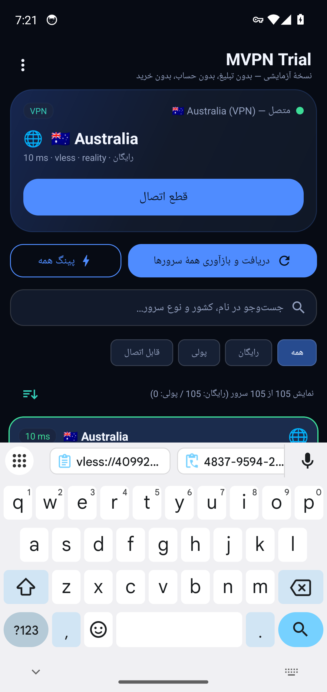
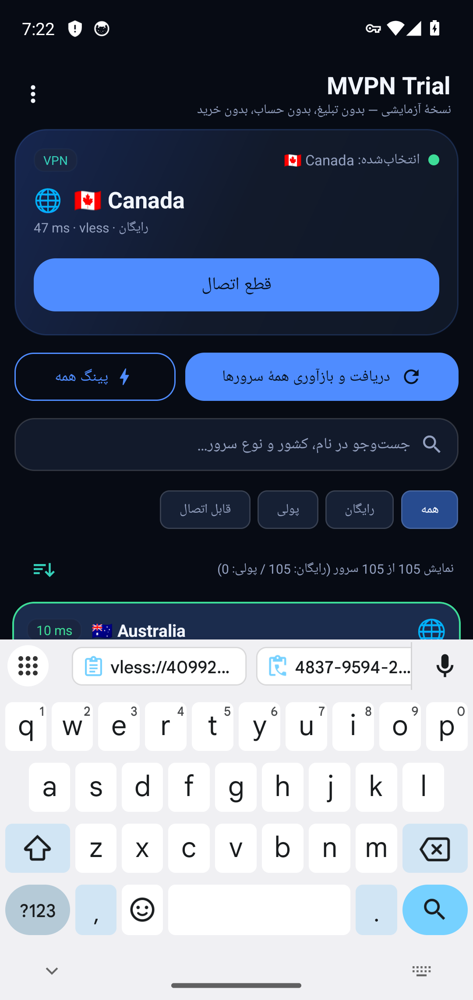
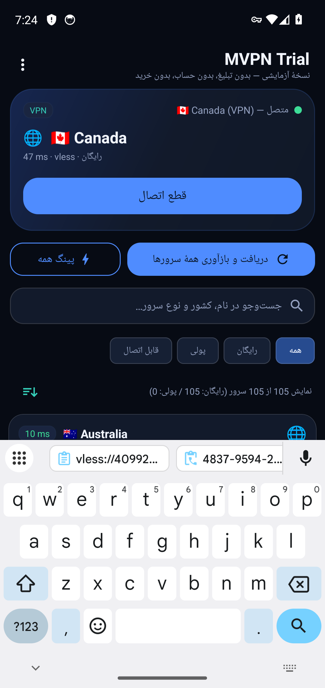
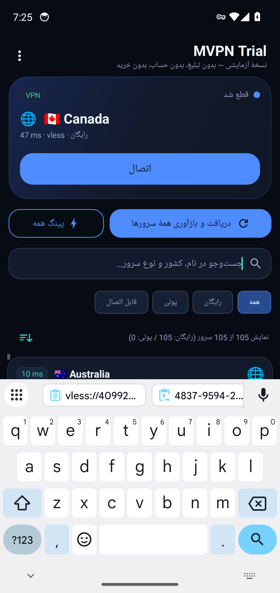

# e2e-real — run 42

- branch: arena/b9372ae1-myvpn
- sha: 3b3df66b1ed2d6c15c4a5405d6eb9060e4adf962
- started: 2026-10-27T07:17:48Z
- kvm: crw-rw-rw- 1 root kvm 10, 232 Oct 27 07:13 /dev/kvm
- booted: 1
- apk: android-app/app/build/outputs/apk/release/app-release.apk
Performing Streamed Install
Success

- e2e exit: 0
- outcome jdk: success
- outcome sdk: success
- outcome chmod: success
- outcome aar: success
- outcome hev: success
- outcome key: success
- outcome gradlesetup: success
- outcome apk: success
- outcome emusetup: success
- outcome drive: success

## gradle
```
```

---

# آزمون اتصال واقعی به بک‌اند اصلی (بدون هیچ ورودی کاربر)

- زمان: 2026-10-27T07:25:35Z
- آدرس آزمون: `http://1.1.1.1/cdn-cgi/trace`
- سرور متصل‌شده: `🇦🇺 Australia`

## گام‌ها

- پاک‌کردن دادهٔ برنامه (بدون کش، بدون کانفیگ ذخیره‌شده)
- ابزار HTTP روی شبیه‌ساز: `nc`
- IP خروج پیش از اتصال: `None` (success/United States)
- درخواست بدون تونل: HTTP 301
- فهرست بارگذاری شد: 3 ردیف روی صفحه — خلاصه: `نمایش 105 از 105 سرور (رایگان: 105 / پولی: 0)`
- نمونهٔ برچسب ردیف‌ها: `🇺🇸 United States`، `🇺🇸 United States`، `🇺🇸 United States`
- مرتب‌سازی: درست — سه ردیف اول: `🇦🇺 Australia`، `🇦🇺 Australia`، `🇦🇺 Australia`
- کپی همهٔ لینک‌ها: درست — 104 لینک v2ray در کلیپ‌بورد قرار گرفت
- پایان پینگ همه: بله
- سروری که برنامه خودش انتخاب کرد: `🌐  🇺🇸 United States` (پینگ 8 ms)
- ردیف‌های دارای پینگ در فهرست: 30
- اتصال به سرور انتخاب‌شده: `🇦🇺 Australia`
- دیالوگ مجوز VPN تأیید شد
- وضعیت تونل: `متصل — &#127462;&#127482; Australia (VPN)`
- رابط tun0: موجود
- درخواست از داخل تونل: HTTP 301
- ترافیک از تونل عبور کرد (تلاش 1 از 5)
- IP خروج داخل تونل: `None` (success — United States)
- ردیف‌های نامزد برای تغییر سرور: 3 (از 30 ردیف دارای پینگ)
- تغییر سرور به: `🇨🇦 Canada` (41 ms)
- وضعیت تونل: `متصل — &#127464;&#127462; Canada (VPN)`
- برچسب دکمه پس از انتخاب سرور دوم: `قطع اتصال`
- درخواست پس از تغییر سرور: HTTP 301
- برچسب دکمه پیش از قطع: `قطع اتصال`
- پس از قطع اتصال: tun0 حذف شد

## تصاویر










## نتیجه

**موفق** — برنامه بدون هیچ ورودی کاربر، فهرست را از بک‌اند گرفت، مقدار رمزشدهٔ هر ردیف را خودش باز کرد، سریع‌ترین سرور را خودش انتخاب کرد، وصل شد و ترافیک از تونل عبور کرد، سرور عوض شد و اتصال تمیز قطع شد.
