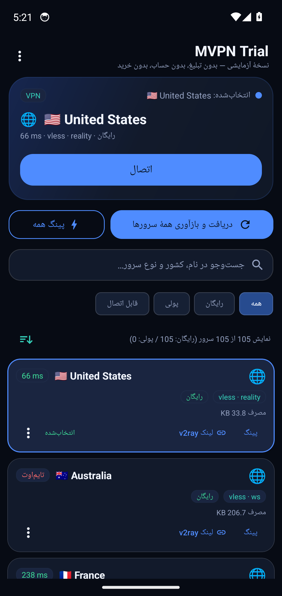
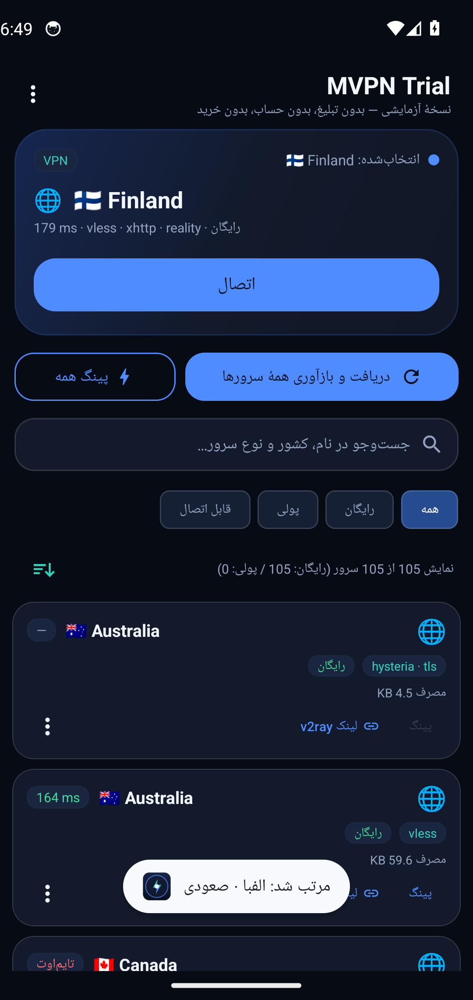
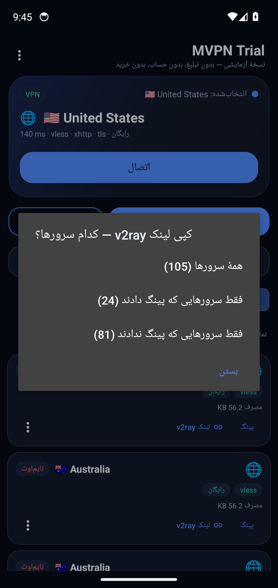
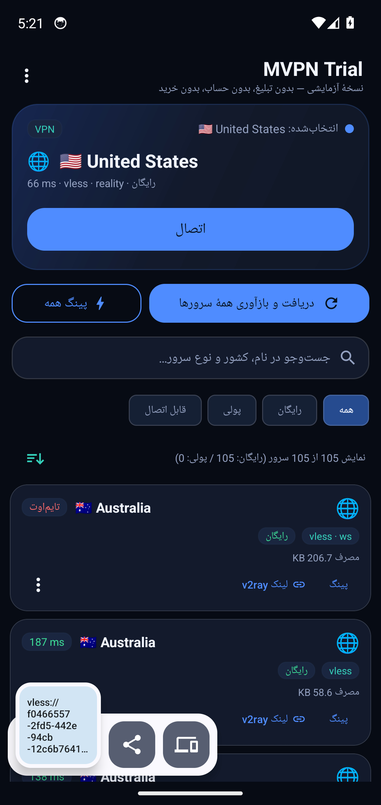
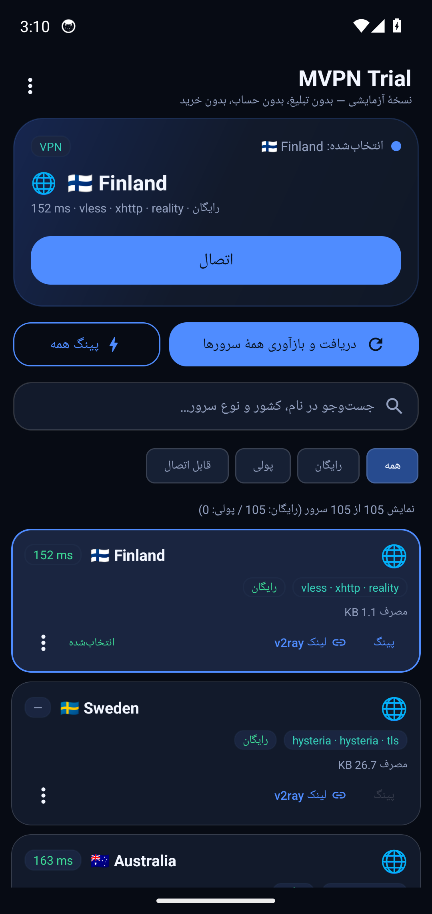
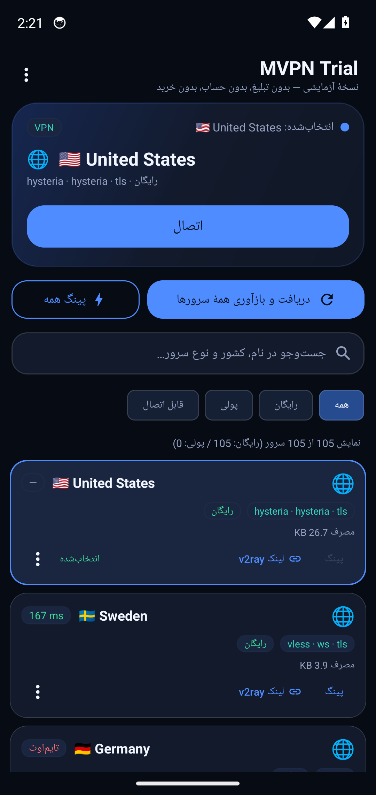
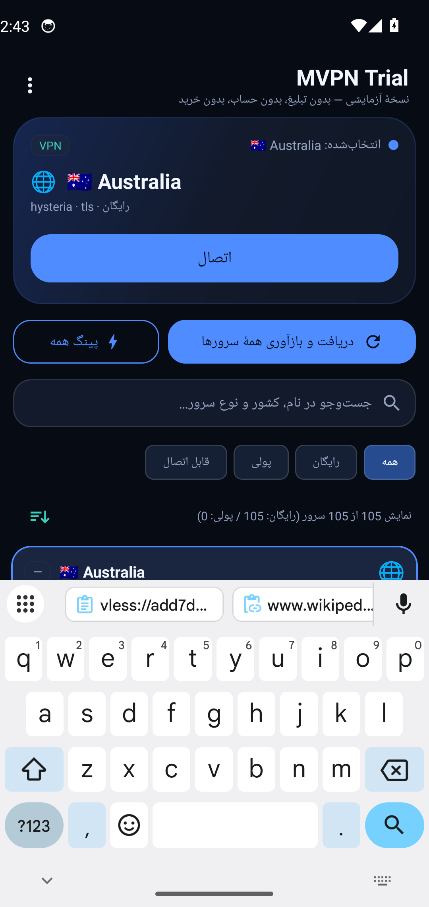
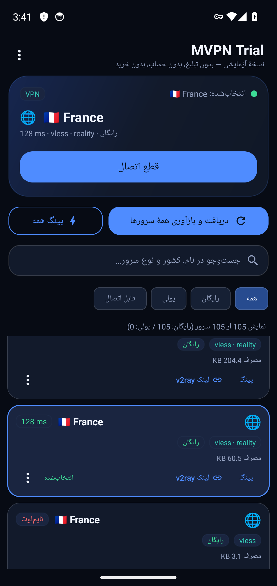
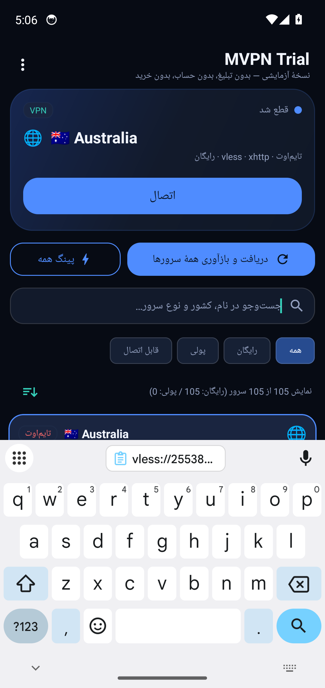

# e2e-real — run 27

- branch: arena/b9372ae1-myvpn
- sha: 36901f8135e3056be305c4ebdd4e8ddbad052c4c
- started: 2026-10-27T01:30:59Z
- kvm: crw-rw-rw- 1 root kvm 10, 232 Oct 27 01:24 /dev/kvm
- booted: 1
- apk: android-app/app/build/outputs/apk/release/app-release.apk
Performing Streamed Install
Success

- e2e exit: 1
- outcome jdk: success
- outcome sdk: success
- outcome chmod: success
- outcome aar: success
- outcome hev: success
- outcome key: success
- outcome gradlesetup: success
- outcome apk: success
- outcome emusetup: success
- outcome drive: failure

---

# آزمون اتصال واقعی به بک‌اند اصلی (بدون هیچ ورودی کاربر)

- زمان: 2026-10-27T01:43:03Z
- آدرس آزمون: `http://1.1.1.1/cdn-cgi/trace`

## گام‌ها

- پاک‌کردن دادهٔ برنامه (بدون کش، بدون کانفیگ ذخیره‌شده)
- ابزار HTTP روی شبیه‌ساز: `nc`
- IP خروج پیش از اتصال: `None` (success/United States)
- درخواست بدون تونل: HTTP 301
- فهرست بارگذاری شد: 3 ردیف روی صفحه — خلاصه: `نمایش 105 از 105 سرور (رایگان: 105 / پولی: 0)`
- نمونهٔ برچسب ردیف‌ها: `🇨🇦 Canada`، `🇸🇪 Sweden`، `🇩🇪 Germany`
- مرتب‌سازی: درست — سه ردیف اول: `🇦🇺 Australia`، `🇦🇺 Australia`، `🇦🇺 Australia`
- کپی همهٔ لینک‌ها: درست — 103 لینک v2ray در کلیپ‌بورد قرار گرفت
- پایان پینگ همه: بله
- سروری که برنامه خودش انتخاب کرد: `🌐  🇺🇸 United States` (پینگ 18 ms)
- ردیف‌های دارای پینگ در فهرست: 9
- اتصال به سرور انتخاب‌شده: `🇨🇦 Canada`
- دیالوگ مجوز VPN تأیید شد
- خطاهای برنامه:
```
سنجش تأخیر ناموفق
go.Universe$proxyerror: config load error: infra/conf/serial: failed to parse json config > infra/conf: failed to build outbound config with tag proxy > infra/conf: vless without TLS or other encryption is prohibited unless the server address is a private IP or domain
go.Universe$proxyerror: Get "https://www.gstatic.com/generate_204": io: read/write on closed pipe
```
- ردیف 1 وصل نشد؛ ردیف بعدی
- تلاش 2: اتصال به `🇨🇦 Canada` (74 ms)
- دیالوگ مجوز VPN تأیید شد
- خطاهای برنامه:
```
سنجش تأخیر ناموفق
go.Universe$proxyerror: config load error: infra/conf/serial: failed to parse json config > infra/conf: failed to build outbound config with tag proxy > infra/conf: vless without TLS or other encryption is prohibited unless the server address is a private IP or domain
go.Universe$proxyerror: Get "https://www.gstatic.com/generate_204": io: read/write on closed pipe
```
- ردیف 2 وصل نشد؛ ردیف بعدی
- تلاش 3: اتصال به `🇨🇦 Canada` (77 ms)
- دیالوگ مجوز VPN تأیید شد
- خطاهای برنامه:
```
سنجش تأخیر ناموفق
go.Universe$proxyerror: config load error: infra/conf/serial: failed to parse json config > infra/conf: failed to build outbound config with tag proxy > infra/conf: vless without TLS or other encryption is prohibited unless the server address is a private IP or domain
go.Universe$proxyerror: Get "https://www.gstatic.com/generate_204": io: read/write on closed pipe
```
- ردیف 3 وصل نشد؛ ردیف بعدی

## تصاویر




















## نتیجه

**ناموفق**: no-server-passed-traffic
- outcome jdk: success
- outcome sdk: success
- outcome chmod: success
- outcome aar: success
- outcome hev: success
- outcome key: success
- outcome gradlesetup: success
- outcome apk: failure
- outcome emusetup: skipped
- outcome drive: skipped

---

# آزمون اتصال واقعی به بک‌اند اصلی (بدون هیچ ورودی کاربر)

- زمان: 2026-10-27T01:43:03Z
- آدرس آزمون: `http://1.1.1.1/cdn-cgi/trace`

## گام‌ها

- پاک‌کردن دادهٔ برنامه (بدون کش، بدون کانفیگ ذخیره‌شده)
- ابزار HTTP روی شبیه‌ساز: `nc`
- IP خروج پیش از اتصال: `None` (success/United States)
- درخواست بدون تونل: HTTP 301
- فهرست بارگذاری شد: 3 ردیف روی صفحه — خلاصه: `نمایش 105 از 105 سرور (رایگان: 105 / پولی: 0)`
- نمونهٔ برچسب ردیف‌ها: `🇨🇦 Canada`، `🇸🇪 Sweden`، `🇩🇪 Germany`
- مرتب‌سازی: درست — سه ردیف اول: `🇦🇺 Australia`، `🇦🇺 Australia`، `🇦🇺 Australia`
- کپی همهٔ لینک‌ها: درست — 103 لینک v2ray در کلیپ‌بورد قرار گرفت
- پایان پینگ همه: بله
- سروری که برنامه خودش انتخاب کرد: `🌐  🇺🇸 United States` (پینگ 18 ms)
- ردیف‌های دارای پینگ در فهرست: 9
- اتصال به سرور انتخاب‌شده: `🇨🇦 Canada`
- دیالوگ مجوز VPN تأیید شد
- خطاهای برنامه:
```
سنجش تأخیر ناموفق
go.Universe$proxyerror: config load error: infra/conf/serial: failed to parse json config > infra/conf: failed to build outbound config with tag proxy > infra/conf: vless without TLS or other encryption is prohibited unless the server address is a private IP or domain
go.Universe$proxyerror: Get "https://www.gstatic.com/generate_204": io: read/write on closed pipe
```
- ردیف 1 وصل نشد؛ ردیف بعدی
- تلاش 2: اتصال به `🇨🇦 Canada` (74 ms)
- دیالوگ مجوز VPN تأیید شد
- خطاهای برنامه:
```
سنجش تأخیر ناموفق
go.Universe$proxyerror: config load error: infra/conf/serial: failed to parse json config > infra/conf: failed to build outbound config with tag proxy > infra/conf: vless without TLS or other encryption is prohibited unless the server address is a private IP or domain
go.Universe$proxyerror: Get "https://www.gstatic.com/generate_204": io: read/write on closed pipe
```
- ردیف 2 وصل نشد؛ ردیف بعدی
- تلاش 3: اتصال به `🇨🇦 Canada` (77 ms)
- دیالوگ مجوز VPN تأیید شد
- خطاهای برنامه:
```
سنجش تأخیر ناموفق
go.Universe$proxyerror: config load error: infra/conf/serial: failed to parse json config > infra/conf: failed to build outbound config with tag proxy > infra/conf: vless without TLS or other encryption is prohibited unless the server address is a private IP or domain
go.Universe$proxyerror: Get "https://www.gstatic.com/generate_204": io: read/write on closed pipe
```
- ردیف 3 وصل نشد؛ ردیف بعدی

## تصاویر


## نتیجه

**ناموفق**: no-server-passed-traffic
- outcome jdk: success
- outcome sdk: success
- outcome chmod: success
- outcome aar: success
- outcome hev: success
- outcome key: success
- outcome gradlesetup: success
- outcome apk: failure
- outcome emusetup: skipped
- outcome drive: skipped

## gradle
```
> Task :app:compileReleaseKotlin FAILED
e: file:///home/runner/work/Myvpn/Myvpn/android-app/app/src/main/java/co/asiven/vixentvpn/service/VpnTunnelService.kt:168:46 None of the following candidates is applicable:
FAILURE: Build failed with an exception.
* What went wrong:
```

---

# آزمون اتصال واقعی به بک‌اند اصلی (بدون هیچ ورودی کاربر)

- زمان: 2026-10-27T01:43:03Z
- آدرس آزمون: `http://1.1.1.1/cdn-cgi/trace`

## گام‌ها

- پاک‌کردن دادهٔ برنامه (بدون کش، بدون کانفیگ ذخیره‌شده)
- ابزار HTTP روی شبیه‌ساز: `nc`
- IP خروج پیش از اتصال: `None` (success/United States)
- درخواست بدون تونل: HTTP 301
- فهرست بارگذاری شد: 3 ردیف روی صفحه — خلاصه: `نمایش 105 از 105 سرور (رایگان: 105 / پولی: 0)`
- نمونهٔ برچسب ردیف‌ها: `🇨🇦 Canada`، `🇸🇪 Sweden`، `🇩🇪 Germany`
- مرتب‌سازی: درست — سه ردیف اول: `🇦🇺 Australia`، `🇦🇺 Australia`، `🇦🇺 Australia`
- کپی همهٔ لینک‌ها: درست — 103 لینک v2ray در کلیپ‌بورد قرار گرفت
- پایان پینگ همه: بله
- سروری که برنامه خودش انتخاب کرد: `🌐  🇺🇸 United States` (پینگ 18 ms)
- ردیف‌های دارای پینگ در فهرست: 9
- اتصال به سرور انتخاب‌شده: `🇨🇦 Canada`
- دیالوگ مجوز VPN تأیید شد
- خطاهای برنامه:
```
سنجش تأخیر ناموفق
go.Universe$proxyerror: config load error: infra/conf/serial: failed to parse json config > infra/conf: failed to build outbound config with tag proxy > infra/conf: vless without TLS or other encryption is prohibited unless the server address is a private IP or domain
go.Universe$proxyerror: Get "https://www.gstatic.com/generate_204": io: read/write on closed pipe
```
- ردیف 1 وصل نشد؛ ردیف بعدی
- تلاش 2: اتصال به `🇨🇦 Canada` (74 ms)
- دیالوگ مجوز VPN تأیید شد
- خطاهای برنامه:
```
سنجش تأخیر ناموفق
go.Universe$proxyerror: config load error: infra/conf/serial: failed to parse json config > infra/conf: failed to build outbound config with tag proxy > infra/conf: vless without TLS or other encryption is prohibited unless the server address is a private IP or domain
go.Universe$proxyerror: Get "https://www.gstatic.com/generate_204": io: read/write on closed pipe
```
- ردیف 2 وصل نشد؛ ردیف بعدی
- تلاش 3: اتصال به `🇨🇦 Canada` (77 ms)
- دیالوگ مجوز VPN تأیید شد
- خطاهای برنامه:
```
سنجش تأخیر ناموفق
go.Universe$proxyerror: config load error: infra/conf/serial: failed to parse json config > infra/conf: failed to build outbound config with tag proxy > infra/conf: vless without TLS or other encryption is prohibited unless the server address is a private IP or domain
go.Universe$proxyerror: Get "https://www.gstatic.com/generate_204": io: read/write on closed pipe
```
- ردیف 3 وصل نشد؛ ردیف بعدی

## تصاویر


## نتیجه

**ناموفق**: no-server-passed-traffic
